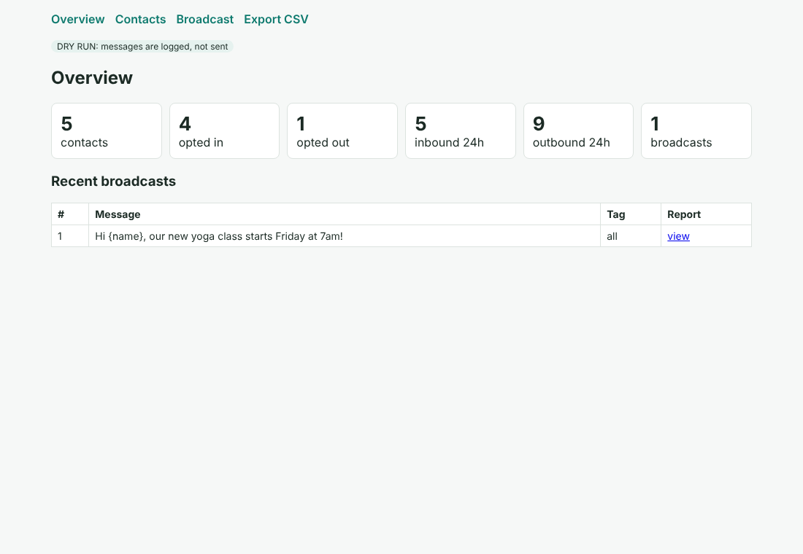

# WhatsApp Admin Automation

A self-hosted tool for running a WhatsApp support line without being online all the time. It uses the **official WhatsApp Business Cloud API**, so it stays within WhatsApp's terms and won't get your number banned.



## What it does

| Feature | How |
|---|---|
| **Welcome message** | New contacts get a personalised greeting (`{name}`) on their first message |
| **FAQ auto-replies** | Keyword matching against FAQs you edit in `config.yaml`; changes apply without a restart |
| **1:1 broadcasts** | Each opted-in contact gets their own personalised copy, never a group message. Filter by tag |
| **24-hour rule handled** | Inside the 24h customer-service window it sends free text. Outside it, it automatically uses your approved template, as Meta requires |
| **Delivery reports** | Tracks sent → delivered → read → failed per message from Meta's status webhooks (out-of-order updates handled) |
| **Contact management** | Add, remove and tag contacts; opt-in/opt-out (users can reply STOP / START); full conversation history |
| **Stats + CSV export** | Dashboard tiles and `/export.csv` (optionally by tag) |
| **Safe webhooks** | Signature verification (`X-Hub-Signature-256`) and duplicate-delivery protection |
| **Dashboard + CLI** | Lightweight web dashboard, plus a CLI for doing everything from the server |

## Quick start (demo mode, no WhatsApp account needed)

```bash
pip install -r requirements.txt
WA_DRY_RUN=1 uvicorn app.main:app --port 8000
# open http://localhost:8000
python -m pytest -q        # 8 tests
```

In dry-run mode, messages are logged instead of sent, so you can try every feature safely.

## Going live

1. In Meta for Developers, create an app with the **WhatsApp** product and get a **permanent access token** and **phone number ID**.
2. Copy `.env.example` to `.env` and fill in `WA_ACCESS_TOKEN`, `WA_PHONE_NUMBER_ID`, `WA_VERIFY_TOKEN`, `WA_APP_SECRET`, and set `WA_DRY_RUN=0`.
3. Run on your VPS behind HTTPS (for example Caddy or Nginx + Let's Encrypt):
   `uvicorn app.main:app --host 0.0.0.0 --port 8000`
4. In the Meta app, set the webhook URL to `https://your-domain/webhook` with the same verify token, and subscribe to the `messages` field.
5. Create and get approval for a template named `announcement` with two body variables (`{{1}}` name, `{{2}}` text). Broadcasts use it for contacts outside the 24h window.

## CLI

```bash
python cli.py add 15551234567 --name "Ana" --tags vip,monthly
python cli.py broadcast "Hi {name}, new class Friday!" --tag vip --delay 0.2
python cli.py report 1
python cli.py export contacts.csv --tag vip
python cli.py stats
```

## Project layout

```
app/config.py    settings (.env) and bot content (config.yaml)
app/db.py        SQLite: contacts, tags, messages, broadcasts
app/whatsapp.py  Cloud API client + webhook signature check
app/bot.py       welcome / FAQ / opt-out logic and broadcasts
app/main.py      FastAPI webhook + dashboard
cli.py           command-line admin
tests/           end-to-end tests with simulated webhooks
```

Built by Pranshu Mishra · Python, FastAPI, automation and AI tools.
